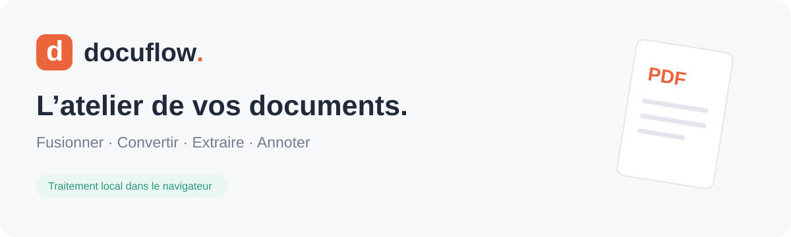
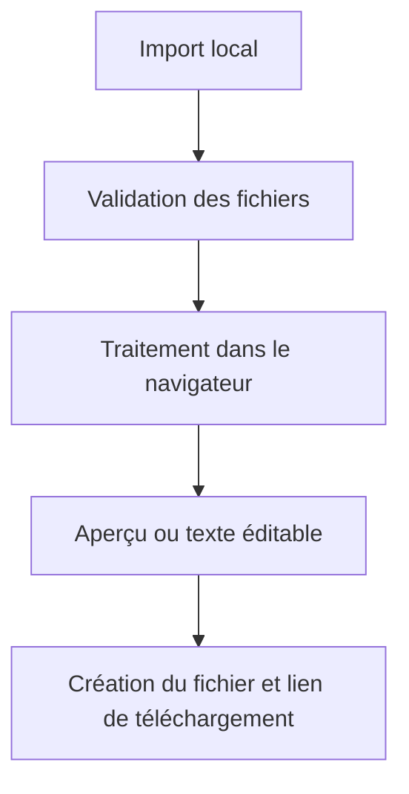

<div align="center">



**Un atelier de documents en français, accessible depuis le navigateur.**

[Faire un essai](https://docuflow-nazmo.adeptmole259.chatgpt.site/) · [Présentation du projet](docs/PRESENTATION.md) · [Architecture et limites](docs/TECHNIQUE.md)


</div>

## Pourquoi Docuflow ?

Assembler des justificatifs, récupérer le texte d’un document ou ajouter une annotation ne devrait pas obliger à installer un logiciel. Docuflow réunit ces opérations dans une interface unique, avec un principe : **les fichiers sont traités en mémoire sur l’appareil de l’utilisateur, sans être envoyés à un serveur de conversion**.

Exemple : importer plusieurs PDF, choisir leur ordre, les fusionner puis récupérer un document prêt à transmettre.

> Projet personnel développé avec assistance IA. Les fonctionnalités présentées correspondent à la version actuelle ; il s’agit d’un prototype fonctionnel, pas d’une suite bureautique complète.

## Ce que l’on peut faire

| Outil | Fonctionnalités disponibles |
| --- | --- |
| **Fusionner** | Réunir plusieurs PDF, changer l’ordre des fichiers et choisir le nom du résultat. |
| **Convertir** | PDF → PNG dans un ZIP, PDF → TXT, PDF → DOCX à partir du texte, JPG/PNG → PDF et TXT/DOCX → PDF. |
| **Extraire** | Récupérer le texte sélectionnable des PDF et le texte des DOCX/TXT, le copier ou le télécharger. |
| **Modifier** | Ajouter des annotations textuelles avec position, taille et couleur ; tourner ou retirer des pages ; annuler une action ; visualiser la page. |
| **Réécrire** | Modifier le texte extrait ou écrire un nouveau document, puis exporter en PDF, DOCX ou TXT. |

L’interface propose aussi le glisser-déposer, un affichage adapté au mobile, des erreurs explicites et un historique en mémoire des douze derniers résultats.

## Démarrage local

Prérequis : **Node.js 22 ou supérieur**, npm et Python 3 pour le serveur de démonstration ci-dessous.

Dans le dossier du projet :

```bash
npm ci
npm run build
python3 -m http.server 8000 --directory dist
```

Ouvrir **http://localhost:8000**. Un autre serveur HTTP statique peut remplacer Python.

Le build produit `dist/`, prêt à être hébergé comme site statique. Les chemins sont relatifs, y compris celui du worker PDF.js, pour permettre un hébergement dans un sous-dossier. Aucun secret, compte fournisseur ni clé API n’est nécessaire au fonctionnement actuel.

## Vérification

```bash
npm test
```

Les **six tests automatisés** portent sur :

1. Le nombre et l’ordre des pages d’une fusion.
2. La conservation du texte accentué dans un PDF généré.
3. La création d’un DOCX et l’extraction de son texte.
4. Les annotations, la rotation et la sélection des pages, sans perte du texte source.
5. Le rejet de fichiers PDF/DOCX invalides et de formats non pris en charge.
6. La pagination d’un long texte.

La version du 28 octobre 2026 a également été essayée dans le navigateur sur les quatre outils, avec contrôle de l’affichage à une largeur mobile. Les fichiers de résultat et leurs liens ont été produits. La récupération du téléchargement par l’outil de test distant a rencontré un délai d’attente : ce dernier point n’a pas été validé de bout en bout.

## Comment ça fonctionne



| Élément | Technologie | Rôle |
| --- | --- | --- |
| Interface | HTML, CSS, JavaScript natif | Navigation, import, état et accessibilité. |
| PDF | pdf-lib, PDF.js, fontkit | Assemblage, création, annotation, extraction et rendu. |
| Word | Mammoth, docx | Extraction du texte DOCX et création de documents éditables. |
| Archives | JSZip | Export des pages PNG dans une archive ZIP. |
| Build | esbuild | Bundle navigateur et assemblage des assets. |
| Tests | `node:test` | Vérification du contenu réel des documents. |

## Confidentialité et limites

- **Pas d’upload de documents** dans la version actuelle. Les outils, les styles et la police sont servis par le site ; aucun CDN tiers n’est nécessaire à son exécution.
- **Pas d’OCR** : un scan sans couche de texte ne peut pas être transcrit.
- **Conversions textuelles simplifiées** : les images, tableaux et mises en page d’origine ne sont pas conservés dans PDF → DOCX ou TXT/DOCX → PDF.
- **Annotation, pas remplacement du texte PDF** : l’éditeur ajoute du contenu et ne fournit pas de caviardage sécurisé.
- **Pas de signature électronique certifiée**, de paiement ou de publicité intégrée.
- Les PDF protégés par mot de passe ne sont pas pris en charge. Une modification peut invalider une signature existante.
- Les fichiers et résultats ne sont pas persistés : ils disparaissent à la fermeture ou au rechargement de la page.

Limites actuelles : **50 Mo/fichier**, **100 Mo/opération**, **30 fichiers**, **300 pages PDF** au total, **150 pages** pour PNG, **40 millions de pixels/image** et **500 000 caractères** pour la création de documents texte. La prise en charge de chaque fichier complexe n’est pas garantie.

## Structure du dépôt

```text
assets/banner.svg          Présentation du projet
public/index.html          Structure de l’interface
public/assets/             Styles et police locale
src/app.js                 Interactions, état et téléchargements
src/documents.js           Transformations de documents
tests/documents.test.mjs  Tests du contenu produit
build.mjs                  Génération de dist/
docs/                      Présentation et documentation technique
```

## Pistes d’évolution

Ces éléments sont envisagés et **ne sont pas encore implémentés** :

- [ ] OCR pour les documents scannés.
- [ ] Réorganisation visuelle des pages PDF.
- [ ] Amélioration de la fidélité des conversions bureautiques.
- [ ] Tests navigateur automatisés des téléchargements.
- [ ] Déploiement et vérifications automatisés sur GitHub.

## Auteur et dépendances

Projet de **[NAZMO1](https://github.com/NAZMO1)**. Les bibliothèques et la police conservent leurs licences respectives ; voir [les dépendances](docs/TECHNIQUE.md#dépendances-et-licences) et [la licence de la police](public/assets/FONT-LICENSE.txt). Aucune licence de redistribution n’a encore été choisie pour le code propre du projet.
